# Smart-Town

[](https://github.com/Trapilaos/Smart-Town/actions/workflows/ci.yml)


A municipality platform: citizens browse events, parking, bins and the street-lighting schedule and pay a bill without an account, and municipality staff run the town from an admin side with maps, collection routes, invoices and an audit log.

Developed during the 2023-2024 academic year under the guidance of Prof. Efthymios Alepis. In 2026 it was modernised and extended into the platform described here, using an AI-assisted workflow (see [How this was built](#how-this-was-built)).

## What it is

Smart-Town has two sides on one Angular client and one ASP.NET Core API:

- **Public side.** Anyone can open the events list, the parking and waste maps, the lighting schedule and the pay-a-bill page. No sign-in.
- **Admin side.** Municipality staff (the `Admin` role) manage the boundary, bins, parking, events, invoices and users.

Everything on the maps is placed inside the municipality boundary, which is fetched from OpenStreetMap.

## Features

**Public (no account)**
- Events list with category filter and upcoming/past toggle, plus event detail pages.
- Parking map with free/full status per space, computed at read time from active reservations.
- Waste bin map with fill level (colour-coded) and a bin-type filter.
- Street-lighting schedule for the next 7 nights (computed from the sun, see below), with the current status and estimated energy.
- Pay a bill: invoice number plus an 8-character payment code. Payment is simulated, no money moves.

**Citizen (account)**
- Register and log in (JWT).
- "I'm interested" on events, and comments.
- Reserve a parking space for a time window.
- "My invoices", and the traffic page (traffic data is simulated by the app).

**Municipality staff (admin)**
- Dashboard: bins at 80% or more, free parking now, unpaid total, overdue invoices, upcoming events, recent activity and comments to review.
- Municipality settings: name, centre, streetlight count and wattage, and the boundary. Search OpenStreetMap for the boundary, or paste GeoJSON as an advanced fallback.
- Waste bins: click the map to add, edit, empty or remove a bin. Bins outside the boundary are rejected.
- Collection route: nearest-neighbour tour improved with 2-opt, starting and ending at the municipality centre, printable.
- Parking, events (including drafts) and invoices: create, edit and delete, with an invoice summary.
- User management and an audit log of every admin change.

## Screenshots

Taken from the running app with the Development seed data.

<table>
  <tr>
    <td>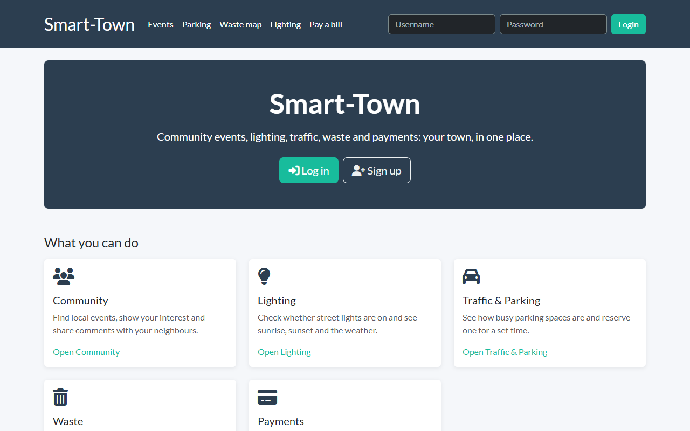<br><sub>Home</sub></td>
    <td>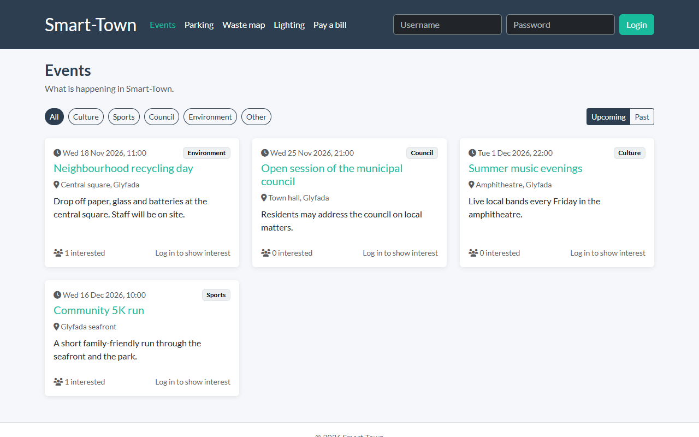<br><sub>Events (public)</sub></td>
  </tr>
  <tr>
    <td>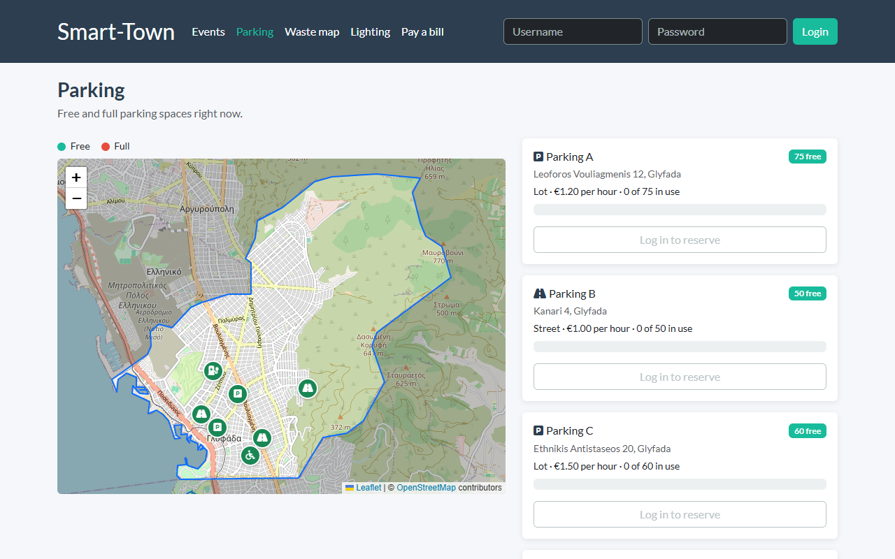<br><sub>Parking map (public)</sub></td>
    <td>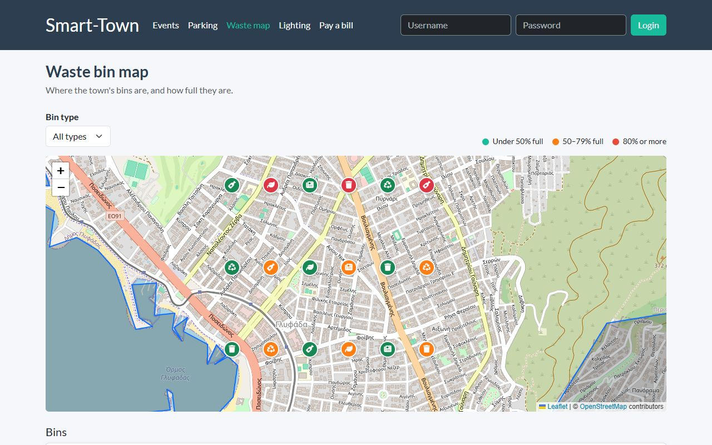<br><sub>Waste bin map (public)</sub></td>
  </tr>
  <tr>
    <td>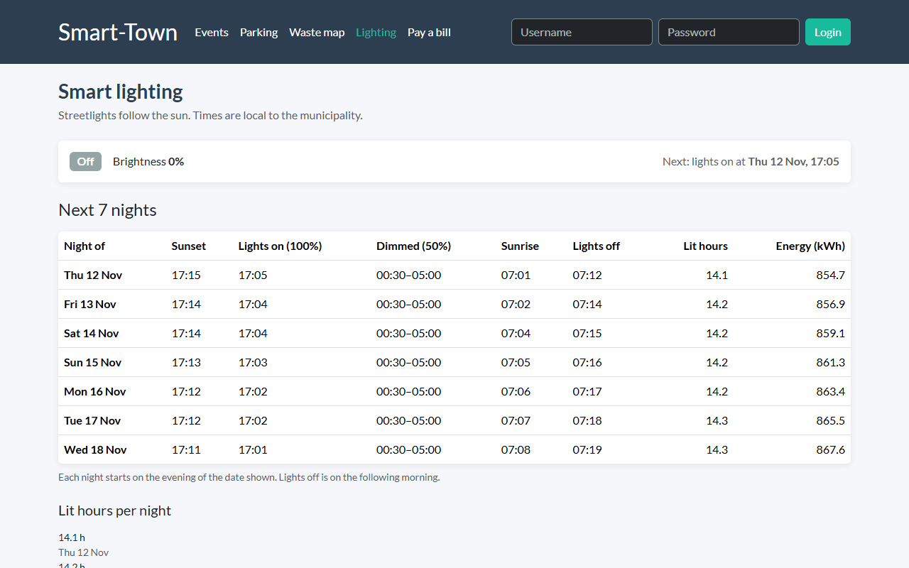<br><sub>Lighting schedule, computed from the sun</sub></td>
    <td>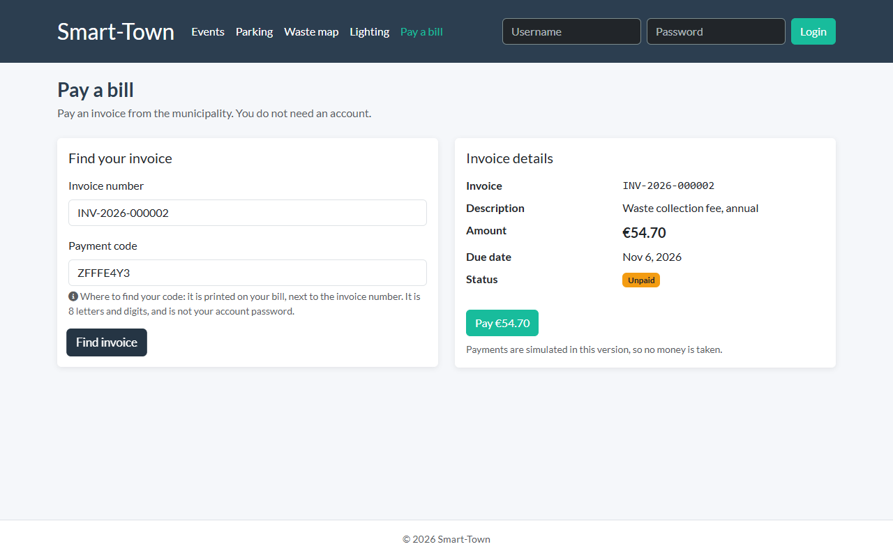<br><sub>Pay a bill, invoice found by number and code</sub></td>
  </tr>
  <tr>
    <td>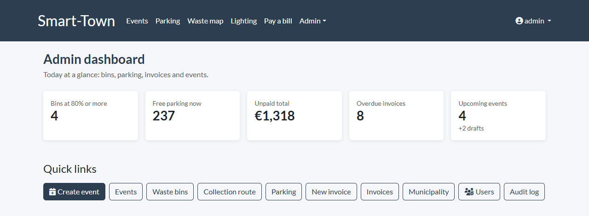<br><sub>Admin dashboard</sub></td>
    <td>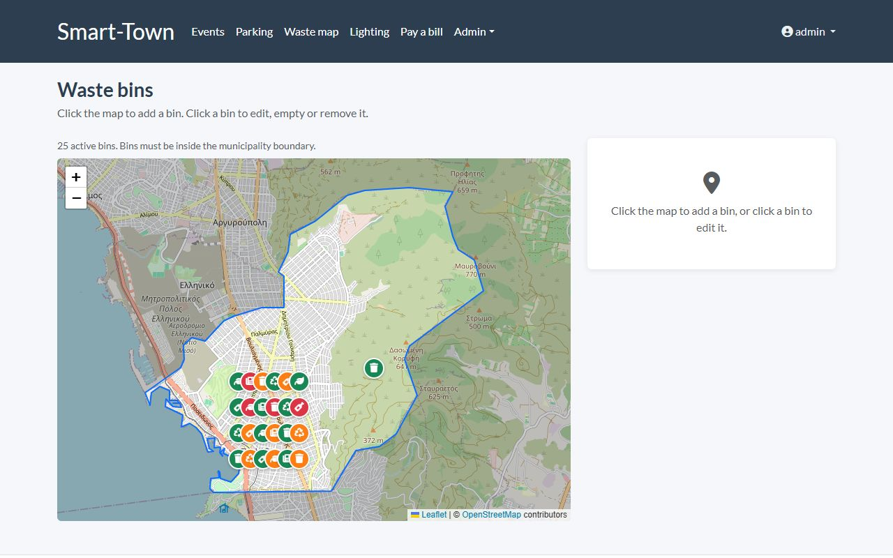<br><sub>Admin: bins on the map</sub></td>
  </tr>
  <tr>
    <td>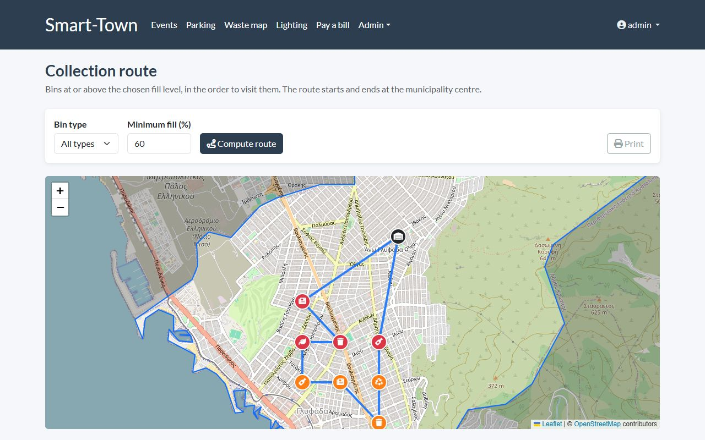<br><sub>Admin: collection route</sub></td>
    <td>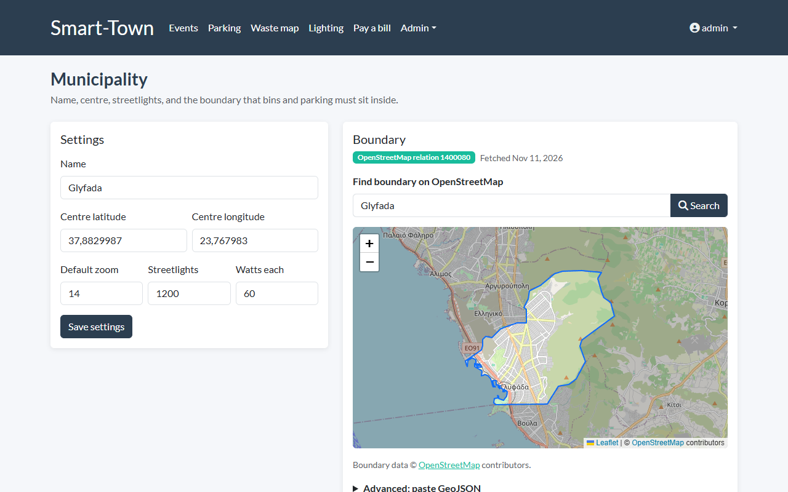<br><sub>Admin: municipality boundary from OpenStreetMap</sub></td>
  </tr>
  <tr>
    <td>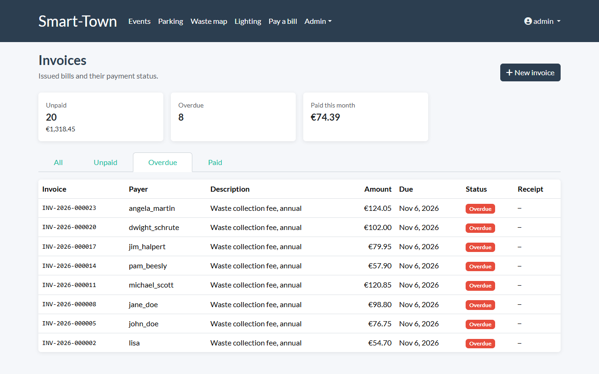<br><sub>Admin: invoices (overdue tab)</sub></td>
    <td>
      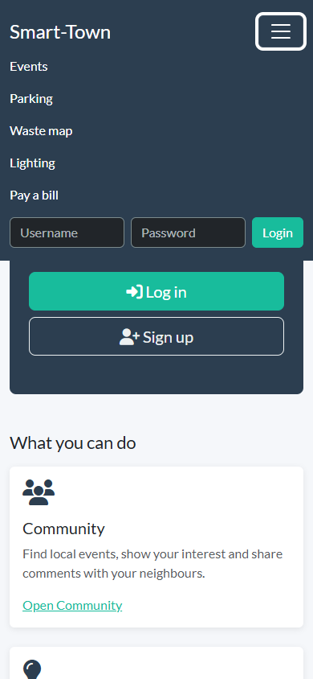
      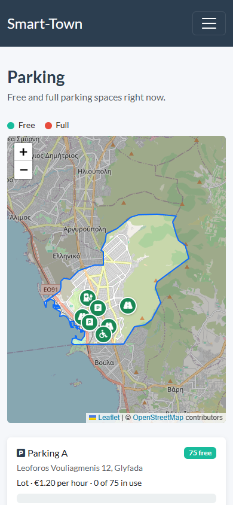<br><sub>Mobile (390 px): menu and parking</sub>
    </td>
  </tr>
</table>

## Architecture

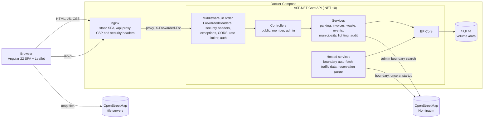

Domain model (user links are stored as ids, and only `EventInterest` has a database foreign key to `Event`):

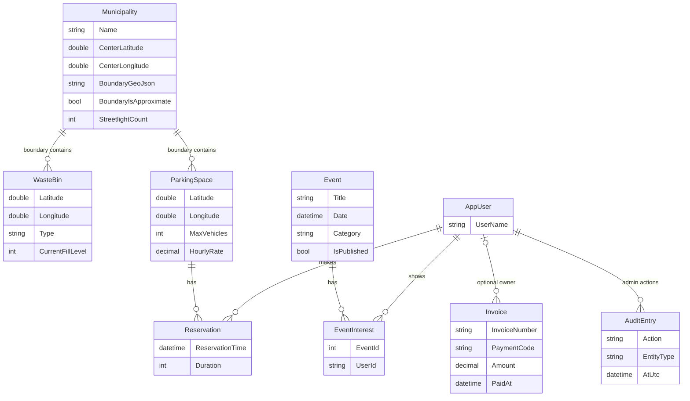

The "boundary contains" links are enforced in code (a bin or space outside the boundary is rejected with 400), not by a foreign key.

### Key design decisions

- **Lighting is computed, not fetched.** `SolarCalculator` implements the NOAA sunrise/sunset equations for the municipality centre and time zone. `LightingScheduleService` then applies a fixed policy: on at 100% ten minutes before sunset, dimmed to 50% from 00:30 to 05:00, off ten minutes after sunrise, with energy from streetlight count x wattage x hours. No external API, no key, and it is unit-tested against known Athens sunrise/sunset times.
- **The boundary comes from OpenStreetMap, with a fallback.** A hosted service fetches the municipality polygon from Nominatim once at startup (generic User-Agent, at most one request per second). If that fails, the seeded approximate outline stays and startup is never blocked. Every geometry, fetched or pasted, goes through the same validation (shape, size, coordinate ranges, closed rings).
- **Payment codes stop invoice enumeration.** A public lookup needs the invoice number and an 8-character code drawn from a cryptographic RNG. The code is compared in constant time, and a wrong code and an unknown number return the identical 404.
- **Parking capacity is the peak occupancy.** A reservation is accepted only if the number of cars parked at the same time never exceeds the space's capacity at any moment of the requested window. The check and the insert run in one write transaction with a process-wide semaphore, so concurrent bookings cannot overfill a space.
- **Public reads never write.** `GET /api/parking` computes free spaces at read time. Expired reservations are purged by a hosted service every 15 minutes.
- **The real client address matters.** The API trusts `X-Forwarded-For` only from configured proxy networks, so rate limits are per citizen and not per nginx container.
- **Collection route.** Nearest-neighbour from the depot, then 2-opt until no gain, using haversine distance. It replaced a hard-coded graph.
- **Everything is stored in UTC**, and converted to the municipality time zone (`Europe/Athens` by default) for display.

## Tech stack

| Layer | Technology |
|---|---|
| API | ASP.NET Core on .NET 10, EF Core 10 with SQLite, ASP.NET Identity, JWT bearer (HS512), AutoMapper 14 |
| Client | Angular 22 (NgModule style), TypeScript 6, Bootstrap 5 with Bootswatch, ngx-bootstrap 22, ngx-toastr 20, Leaflet 1.9.4 |
| Maps | OpenStreetMap tiles and Nominatim |
| Tests | xUnit 2.9 with `Microsoft.AspNetCore.Mvc.Testing` (API), Karma and Jasmine in headless Chrome (client) |
| Delivery | Docker Compose (nginx and the API), GitHub Actions CI |

SDK pins: `global.json` requires the .NET SDK 10.0.100 or later in the 10.0 feature band (`rollForward: latestFeature`). The client Docker image and CI use Node 24.

## Getting started

### Local development

Prerequisites: the .NET 10 SDK and Node 24 (the lockfile is written by npm 11).

1. Set the JWT signing key (at least 64 characters; the app refuses to start without one):

   ```bash
   cd API
   dotnet user-secrets set "TokenKey" "<a random string of 64 or more characters>"
   ```

2. Run the API. The `api` launch profile uses the Development environment and listens on `http://localhost:5000` and `https://localhost:5001` (run `dotnet dev-certs https --trust` once if you have never trusted the dev certificate):

   ```bash
   dotnet run
   ```

   In Development the API creates and migrates `Smarttown.db` next to the project and seeds the municipality content, demo residents, demo invoices and an `admin` account. The demo accounts are Development-only, and their password is the `UserSeed` constant in `API/Data/Seeds/UserSeed.cs`. Never use them outside local development. An OpenAPI document is served at `/openapi/v1.json` in Development only.

3. Run the client in a second terminal:

   ```bash
   cd client
   npm ci
   npm start
   ```

   `ng serve` proxies `/api` to `https://localhost:5001` (see `client/proxy.conf.json`), so the browser only talks to one origin. The `serve` options in `angular.json` ask for TLS with `client/ssl/localhost.pem` and a matching `localhost-key.pem` that is not in the repository. Either generate your own pair there (for example with `mkcert`), or serve over plain HTTP with `npm start -- --ssl false` and open `http://localhost:4200`.

### Docker

```bash
cp .env.example .env
# edit .env: set TOKEN_KEY (64+ characters) and ADMIN_PASSWORD
docker compose up --build
```

Open http://localhost:8080. `docker-compose.yml` refuses to start if either variable is missing.

- `TOKEN_KEY` is the JWT signing key. `openssl rand -base64 64` makes a good one.
- `ADMIN_PASSWORD` is the initial password of the `admin` account. It is used only when no admin exists yet, and must be at least 6 characters with an upper case letter, a lower case letter and a digit.
- Production runs without demo residents or demo invoices. The municipality content (boundary, bins, parking spaces, events) is seeded when its tables are empty.
- The SQLite database lives in the `api-data` volume, so it survives container replacement.

## Configuration

Keys use `:` in `appsettings.json` and `__` in environment variables (`RateLimits__AuthPerMinute`). Defaults are the ones in the code.

| Key | Default | Purpose |
|---|---|---|
| `TokenKey` | none, required | JWT signing key, at least 64 characters, not the `CHANGE-ME` placeholder. Use user-secrets or an environment variable. |
| `ConnectionStrings:DefaultConnection` | `Data Source=Smarttown.db` | SQLite file. Compose sets `/data/smarttown.db`. |
| `Jwt:Issuer`, `Jwt:Audience` | `SmartTown.Api`, `SmartTown.Client` | Token issuer and audience. |
| `Jwt:ExpiryDays` | `7` | Token lifetime. |
| `Cors:AllowedOrigins` | `["https://localhost:4200"]` | Allowed browser origins. Not needed when the client is served through the proxy. |
| `Seed:DemoData` | `true` in Development, otherwise `false` | Seed demo residents and invoices. |
| `Seed:AdminUsername` | `admin` | Username of the seeded admin. |
| `Seed:AdminPassword` | none | Password for the first admin outside Development. Without it no admin is created and a warning is logged. |
| `RateLimits:GlobalPerMinute` | `300` | Requests per minute per client, all endpoints. |
| `RateLimits:AuthPerMinute` | `10` | Login and register. |
| `RateLimits:PublicInvoicePerMinute` | `5` | Public invoice lookup and pay. |
| `RateLimits:BoundarySearchPerMinute` | `10` | Admin boundary search. |
| `ForwardedHeaders:KnownNetworks` | loopback only | CIDR networks whose `X-Forwarded-For` is trusted. Compose sets `172.28.0.0/24`. |
| `ForwardedHeaders:KnownProxies` | loopback only | Individual proxy IPs to trust. Setting either list replaces the loopback default. |
| `Municipality:AutoFetchBoundary` | `true` | Fetch the boundary from OpenStreetMap once at startup, while it is still approximate. |
| `Municipality:BoundaryQuery` | `Municipality of Glyfada` | Search text for that fetch. |
| `Municipality:NominatimMinIntervalMs` | `1000` | Minimum gap between Nominatim requests. |
| `LoginThrottle:MaxFailures`, `WindowSeconds`, `BlockSeconds` | `5`, `600`, `600` | Failed-login throttle per username and client address. |

## Security

- **Per-client rate limits.** Fixed-window limits per client IP for everything, login, public invoices and boundary search, with 429 and `Retry-After`. Forwarded headers are processed first, and only from configured proxy networks, so the limiter sees the real client behind nginx and clients cannot choose their own address.
- **Security headers.** The API sends `nosniff`, `X-Frame-Options: DENY`, a strict referrer policy, a locked-down Permissions-Policy, `default-src 'none'` CSP, and HSTS outside Development. nginx serves the SPA with a CSP that allows only its own origin and the OpenStreetMap tile hosts.
- **Login throttle, not lockout.** Failed logins are counted per (username, client address), so an attacker cannot lock the real admin out. A generic 401 is returned either way, and there is no username alias for the admin.
- **Payment codes.** Cryptographically random, compared in constant time, and the same 404 for a wrong code and an unknown invoice, so invoices cannot be enumerated.
- **No personal data in public APIs.** Public responses never include user ids, emails or phone numbers, and admin reservation lists show usernames only.
- **Authorization and audit.** Every `/api/admin/*` controller requires the Admin role. Admin creates, updates and deletes, and municipality changes, are recorded in an audit log.
- **Demo data is Development-only.** Production creates its first admin only from `Seed__AdminPassword`. The test controller is not registered outside Development.
- **Fail fast.** If the migration or seeding fails, the API exits instead of serving against a half-ready database.
- **Client tokens.** The JWT is decoded base64url-safely, expiry is checked, and an expired session logs out cleanly.

Early commits in the git history contain secrets that were later removed: a JWT signing key, a weather API key, a TLS private key and a SQLite database. They are no longer used, but anything that was ever real should be rotated and treated as public. `AutoMapper` is pinned to 14.0.0, the last MIT-licensed line, and NuGet reports an advisory against it during restore; this is a known item to revisit.

The full list of findings and fixes is in [docs/REVIEW-FIXES.md](docs/REVIEW-FIXES.md).

## Testing and CI

**API tests (xUnit):** 241 tests covering the API surface, geo and routing maths, the solar calculator, security and rate limiting, and the concurrency fixes (parking, invoice numbers, event interest).

```bash
export TokenKey="<any string of 64 or more characters>"
dotnet test SmartTown.sln
```

If the API is already running it locks `API/bin`. In that case build to another folder, for example `dotnet test API.Tests/API.Tests.csproj -p:OutDir=<some-temp-dir>/`.

**Client tests (Karma and Jasmine):** 113 specs in headless Chrome.

```bash
cd client
npx ng test --watch=false --browsers=ChromeHeadlessCI
```

Karma needs a local Chrome. Set `CHROME_BIN` if it is not found.

**CI** (`.github/workflows/ci.yml`, on every push and pull request):

1. `api`: restore, build and test the solution on .NET 10, and upload the test results.
2. `client`: `npm ci`, a production build and the headless Chrome tests, on Node 24.
3. `docker`: after both pass, build the API and client images (without pushing).

## How this was built

The 2026 modernisation and the municipality platform were built with a deliberately staged, multi-model Claude Code workflow, with a human approving the plan before any code was written and nothing pushed without approval:

| Phase | Model | Role |
|---|---|---|
| Repository map | Haiku | Fast read-only survey |
| Audit and plan | Opus | Ranked the risks, wrote the plan |
| Implementation | Sonnet | .NET 10 and Angular 22 upgrade, tests, CI and Docker, in parallel worktrees |
| UI overhaul | Opus plans, Haiku builds, Sonnet tests | Fixes from a hands-on browser review |
| Municipality platform | Opus plans, Haiku builds, Sonnet tests | Maps, bins, lighting, parking, events, invoices, security |
| Review | Opus | Reviewed the merged result and found 10 issues, all fixed and retested |
| Documentation | Sonnet | This README, screenshots and diagrams |

Details, decisions and the defects found along the way are in [docs/AI-WORKFLOW.md](docs/AI-WORKFLOW.md), [docs/MUNICIPALITY-PLAN.md](docs/MUNICIPALITY-PLAN.md), [docs/UI-PLAN.md](docs/UI-PLAN.md) and [docs/REVIEW-FIXES.md](docs/REVIEW-FIXES.md).

## Credits

- Developed during the 2023-2024 academic year under the guidance of Prof. Efthymios Alepis.
- Map data and tiles: © [OpenStreetMap](https://www.openstreetmap.org/copyright) contributors, available under the Open Database Licence (ODbL). Municipality boundaries are fetched from OpenStreetMap through Nominatim.
- Maps are rendered with [Leaflet](https://leafletjs.com/).
